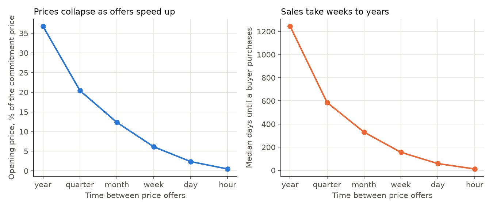
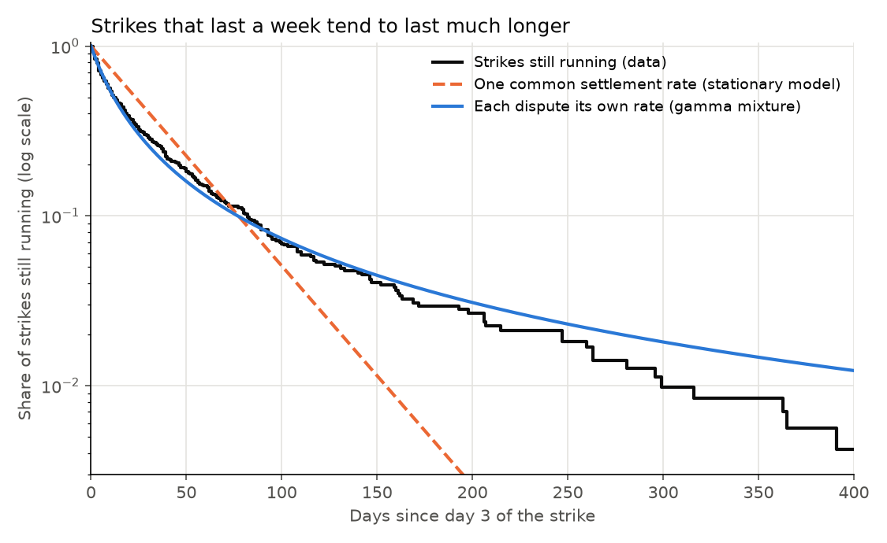
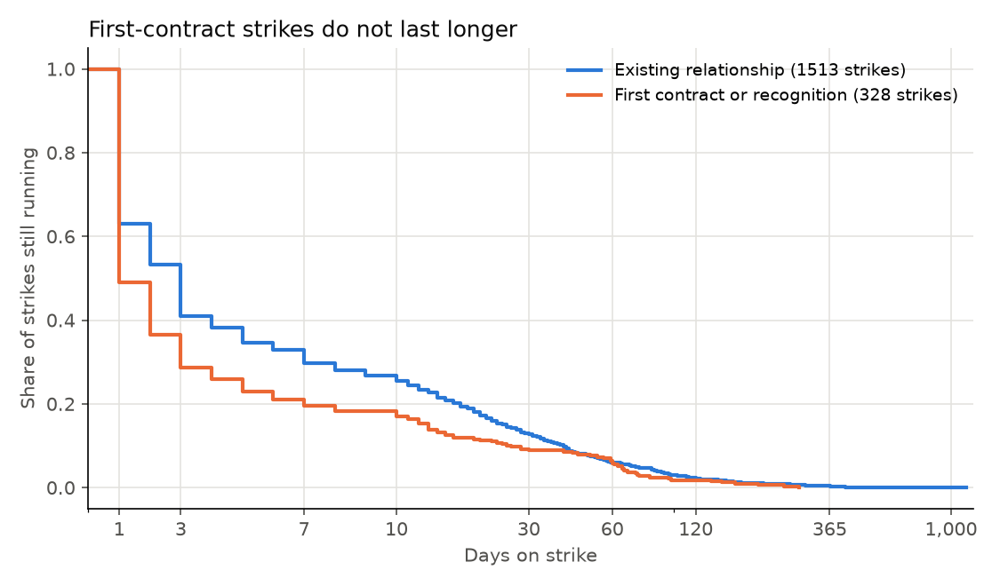

# Bargaining Against Yourself

### In 1986, Faruk Gul, Hugo Sonnenschein and Robert Wilson proved that a seller who cannot promise to hold firm ends up bargaining against his own future offers. I asked what their theory predicts about how long American strikes last, and checked it against 1,984 of them.

---

On September 13, 2024, about 33,000 machinists walked off the job at Boeing. They stayed out for 54 days. A year earlier the United Auto Workers struck General Motors, Ford and Stellantis for 46 days, Kaiser Permanente's 75,000 health-care workers struck for 3, and the screen actors of SAG-AFTRA held out against the Hollywood studios for 120. The Writers Guild's strike against the same studios ran 149 days. At the far end, 60 members of the Pittsburgh Newspaper Guild struck the *Pittsburgh Post-Gazette* in October 2022 and did not come back until November 2025, 1,133 days later.

Each of those disputes was a negotiation in which both sides lost something every day it went on. Economic theory has a sharp prediction about negotiations like these, and it comes from an unexpected place, the theory of how a monopolist prices something that lasts.

---

## The seller who competes with himself

In 1972 Ronald Coase pointed out a problem for anyone who sells a durable good. A company that owns all the land in a country would like to sell a few plots at a high price to the buyers who value them most. Once those buyers have paid, it is left holding land that only lower-value buyers will take, and it is tempted to cut the price. Buyers see the cut coming, the ones who value the land most simply wait, and the seller ends up near the competitive price almost at once. Coase conjectured that a monopolist who can change its price quickly has, in effect, no monopoly at all.

Gul, Sonnenschein and Wilson turned that conjecture into a theorem. Their paper models a seller who names a price each period to a continuum of buyers with different values. They chose the example of a seller of mineral water standing at his own spring, able to pump at zero cost and change his price at will. Their headline result, Theorem 3, says that if buyers' strategies depend only on the current price, then as the time between price changes shrinks toward zero, the opening price falls to the lowest buyer's value, or to zero if values run down to zero.

The same mathematics describes bargaining. The paper's note 6.2 shows that a seller making repeated offers to one buyer whose value only the buyer knows is formally the same game. In a strike, the union keeps revising its demand and the employer knows what a settlement is really worth to it, so each round screens out the employers willing to pay the current demand. The theory predicts how long that screening takes, which can be measured.

---

## Two measures

The first measure is how much each round of delay costs. If offers come every $`\Delta`$ days and waiting shrinks the value of a deal at an annual rate $`\rho`$, then a deal one round later is worth a fraction $`\delta`$ of a deal today.

```math
\delta = e^{-\rho\,\Delta}
```

For the price of money alone, the Moody's Baa corporate bond yield averaged 5.22% a year over 2021 to 2025. With one offer a day, that gives

```math
\delta = e^{-0.0522/365} = 0.99986
```

so a day of waiting costs 0.014% of the stake. A strike can cost far more than interest, so in bargaining $`\rho`$ is the full rate at which delay destroys value.

The second measure is the settlement rate of strikes, which statisticians call the hazard. It is the share of strikes still running at the start of a day that end on that day.

```math
h(t) = \frac{\text{strikes ending on day } t}{\text{strikes still running at the start of day } t}
```

Of the 714 strikes in the data that were still going on their fourth day, 148 ended during days 4 to 6, over 1,973 strike-days in all, so the daily settlement rate in that window was

```math
\hat h_{4\text{-}6} = \frac{148}{1{,}973} = 0.075
```

or 7.5% a day. What matters for the theory is how this rate changes as a strike goes on.

| Shape of the daily settlement rate | What it looks like | What it means |
|---|---|---|
| Flat | The same share of open strikes settles every day, on day 5 and on day 200 | Every dispute is screened at the same pace |
| Falling | 7.5% settle early, under 1% after four months | The long strikes are a different kind of dispute |
| Rising | Few settle early, then many at once | Both sides wait for a deadline |

---

## The paper and its authors

Faruk Gul was at the University of Pennsylvania, Hugo Sonnenschein at Princeton and Robert Wilson at Stanford when the paper appeared in the *Journal of Economic Theory* in 1986. Its acknowledgment says Gul and Sonnenschein wrote it during a year visiting the Stanford Business School. Gul is now a professor of economics at Princeton. Sonnenschein went on to serve as president of the University of Chicago from 1993 to 2000. Wilson, a game theorist at Stanford, shared the 2020 Nobel Memorial Prize in Economic Sciences with Paul Milgrom for work on auctions. With John Kennan he later wrote a long survey of bargaining with private information for the *Journal of Economic Literature*.

The paper does three things. Theorem 1 shows that when every buyer values the good above the seller's cost (the "gap" case), there is essentially one equilibrium, prices fall along a fixed path, and the market is cleared after a finite number of offers. Section 4 shows that when values run all the way down to cost (the "no gap" case), the market stays open forever and there can be a continuum of equilibria. Theorem 3 is the Coase conjecture itself.

Their Example 1 has a closed form that carries the whole argument. Assume buyers' values are spread evenly between 0 and 1, the seller's cost is zero, everyone discounts by $`\delta`$ per round, and strategies are stationary, meaning that when the highest remaining value is $`k`$, the seller charges $`\gamma x k`$ to sell to everyone above $`xk`$, with $`\gamma`$ and $`x`$ the same every round. The seller's remaining profit is then $`R(k) = A k^2`$, and

```math
\begin{aligned}
Ak^2 &= \max_{x}\; \gamma\, x(1-x)\,k^2 + \delta A x^2 k^2 \\
0 &= \gamma(1-2x) + 2\delta A x \\
A &= \gamma x(1-x) + \delta A x^2 \;\Rightarrow\; A = \tfrac{1}{2}\gamma x \\
\delta x^2 &= 2x - 1 \;\Rightarrow\; x = \frac{1}{1+\sigma}, \quad \sigma \equiv \sqrt{1-\delta} \\
\alpha &\equiv 1 - x = \frac{\sigma}{1+\sigma}
\end{aligned}
```

The second line is the seller's first-order condition, the third is the value recursion, and substituting one into the other gives the quadratic on the fourth line. In plain English, a fixed share $`\alpha`$ of the remaining buyers is served every round, and the opening price works out to the same number, $`\sigma/(1+\sigma)`$. As rounds get shorter, $`\delta`$ approaches 1, $`\sigma`$ approaches 0, and the opening price collapses, which is Coase's conjecture. The paper's own numbers come back exactly. At $`\delta = 0.9`$ its Example 2 gives 0.8247, 0.3199 and 0.1446 for the three quantities in footnote 13, and my script, using a cubic I derived from the paper's recursions, returns the same values to four decimals.

The strongest objection came three years later. Lawrence Ausubel and Raymond Deneckere showed in *Econometrica* in 1989 that in the no-gap case, equilibria that are not stationary can let the seller hold out and earn close to the full monopoly profit, because buyers who believe the seller will be tough make toughness pay. The paper's own Examples 2 and 3 and its note 6.8 build the multiple and history-dependent equilibria that Ausubel and Deneckere later exploited. So the Coase conjecture is a prediction about stationary play, and whether real negotiators play that way is an empirical question.

---

## How I tested it

The data come from the Labor Action Tracker run by Cornell's School of Industrial and Labor Relations and the University of Illinois, which records each strike its researchers can verify in the United States with employer, union, dates, approximate strikers and demands. I kept the 1,984 strikes that began between January 1, 2021, and September 30, 2026, and set aside the 143 with no recorded end date. Durations count calendar days, start and end inclusive.

Of the strikes with an end date, 61% lasted three days or less and 40% exactly one day, a pile-up that reflects walkouts called for a fixed period. A walkout scheduled to end on Friday is a signal, not a round of screening, so the hazard tests use the 714 strikes still running on their fourth day and count time from there. A constant hazard looks the same from any starting day, so this loses nothing under stationary play.

The paper's Example 1 says a constant share of unsettled disputes ends every round, so durations should follow the exponential distribution. I fit three models to the data by maximum likelihood, treating durations as whole days. Here $`t_i`$ is the number of days strike $`i`$ ran past day 3 and $`S(t)`$ is the share of strikes still running after $`t`$ days.

```math
\begin{aligned}
\text{Exponential:}\quad & S(t) = e^{-\lambda t} \\
\text{Weibull:}\quad & S(t) = e^{-(\lambda t)^{k}}, \qquad H_0\!: k = 1 \\
\text{Gamma mixture:}\quad & S(t) = (1 + \theta\lambda t)^{-1/\theta}, \qquad H_0\!: \theta = 0 \\
\log L &= \textstyle\sum_i \log\big[S(t_i - 1) - S(t_i)\big]
\end{aligned}
```

The Weibull's shape $`k`$ measures whether the hazard rises ($`k > 1`$) or falls ($`k < 1`$). The gamma mixture is what you get if every dispute has its own constant settlement rate $`\lambda_i`$, drawn from a gamma distribution with mean $`\lambda`$ and squared coefficient of variation $`\theta`$. It is the paper's stationary model applied dispute by dispute. Standard errors come from the inverse of the numerical Hessian, and the tests are likelihood ratios. I then convert each fitted daily settlement share into the per-day $`\delta`$ that Example 1 would need, by inverting $`\alpha = \sigma/(1+\sigma)`$.

For the extension I compared first-contract and recognition strikes with all others using a Cox regression,

```math
h_i(t) = h_0(t)\,\exp\!\big(\beta\,\text{First}_i + \gamma_1 \log n_i + \gamma_2\,\text{Auth}_i + \tau_{y(i)}\big), \qquad H_0\!: \beta = 0
```

where $`n_i`$ is the number of strikers (with a dummy when it is missing), $`\text{Auth}_i`$ marks union-authorized strikes, $`\tau_{y(i)}`$ is a start-year effect, and standard errors are clustered by employer.

---

## What American strikes look like

Of the 1,841 strikes with an end date, 12% ran past 30 days and 2.8% past 100. The median strike lasted 3 days and the mean 15.3. Eight of the largest disputes by number of strikers, and two of the longest, show the range.

| Employer | Union | Strikers | Days |
|---|---|---|---|
| Hollywood studios (AMPTP) | SAG-AFTRA | 160,000 | 120 |
| Kaiser Permanente | SEIU, OPEIU, IFPTE | 75,000 | 3 |
| General Motors, Ford, Stellantis | United Auto Workers | 49,700 | 46 |
| University of California | United Auto Workers | 48,300 | 40 |
| Boeing | Machinists (IAM) | 33,000 | 54 |
| AT&T | Communications Workers | 17,000 | 31 |
| Mount Sinai, Montefiore, NewYork-Presbyterian | New York State Nurses Association | 15,000 | 50 |
| Hollywood studios (AMPTP) | Writers Guild of America | 11,500 | 149 |
| Video game companies including Activision and Electronic Arts | SAG-AFTRA | 2,600 | 319 |
| Pittsburgh Post-Gazette | Pittsburgh Newspaper Guild | 60 | 1,133 |

---

## Faster offers cut prices, but delay stays long when waiting is cheap

Example 1 makes a quantitative prediction once the length of a round is fixed. The table shows the stationary equilibrium for the durable-goods seller, with interest at the Baa rate as the only cost of waiting, measured against the price and profit of a seller who could commit.

| Price can change | Opening price, share of commitment price | Profit, share of commitment profit | Median days until a buyer purchases |
|---|---|---|---|
| Once a year | 36.8% | 36.8% | 1,245 |
| Once a month | 12.4% | 12.4% | 330 |
| Once a week | 6.1% | 6.1% | 156 |
| Once a day | 2.4% | 2.4% | 58 |
| Once an hour | 0.5% | 0.5% | 12 |

The price result is Coase's. With daily repricing the seller's opening price is 2.4% of what it could charge with commitment, and its profit is 2.4% of the monopoly profit. Delay falls too, at the same square-root pace in the length of a round, but it starts from a much higher level. The opening price is roughly $`\sqrt{\rho\Delta}`$ while the median wait is roughly $`\ln 2\,\sqrt{\Delta/\rho}`$, so a low cost of waiting keeps the wait long in calendar time. With daily offers and interest as the only cost, half of the buyers are still waiting after 58 days.



For strikes, the theory therefore does not demand instant agreement. The pace of settlement is set by what a day of delay costs relative to the stake.

---

## Strikes do not settle at a constant pace

The daily settlement rate falls steadily the longer a strike lasts.

| Days into the strike | Strikes at risk | Settled | Daily settlement rate | 95% interval |
|---|---|---|---|---|
| 4 to 6 | 714 | 148 | 7.5% | 6.3% to 8.8% |
| 7 to 13 | 566 | 178 | 5.4% | 4.6% to 6.2% |
| 14 to 29 | 388 | 163 | 3.4% | 2.9% to 4.0% |
| 30 to 59 | 225 | 113 | 2.3% | 1.9% to 2.8% |
| 60 to 119 | 112 | 71 | 1.7% | 1.3% to 2.2% |
| 120 and later | 41 | 41 | 0.8% | 0.6% to 1.1% |

A strike on days 4 to 6 is more than nine times as likely to end on a given day as one past its fourth month. The fitted Weibull shape is

```math
\hat k = 0.652 \;(0.617,\ 0.690), \qquad \text{LR} = 293.7, \quad p < 0.001, \quad N = 714
```

A flat hazard ($`k = 1`$) is rejected by a wide margin. The rejection holds for strikes still running on day 8 ($`\hat k = 0.707`$), for union-authorized strikes (0.670), for strikes over pay (0.662), for the 103 strikes with 1,000 or more participants (0.670), and when the 39 strikes that began in 2026 and have no end date yet are treated as still running (0.620).

---

## Each dispute behaves as if stationary, at its own speed

A falling hazard is what you see when you pool disputes that each settle at a constant rate, but at different rates. The fast ones leave early and the slow ones remain. The gamma mixture builds this in, and it fits better than the Weibull in every one of the six samples (for the main sample, AIC 6,137 against 6,155, where lower is better).

```math
\hat\theta = 0.703 \;(0.578,\ 0.854), \qquad \hat\lambda = 0.075, \qquad \text{LR}_{\theta=0} = 311.5, \quad N = 714
```

The data are consistent with the paper's stationary model applied dispute by dispute, and they reject the idea that one $`\delta`$ governs every dispute. Inverting Example 1 shows how much a day of delay would have to cost for each settlement speed to be an equilibrium.

| Dispute | Daily settlement share | Implied loss per day of delay | Multiple of the interest cost | Half settled after |
|---|---|---|---|---|
| Slow (10th percentile) | 1.4% | 0.02% | 1.3 | 51 days |
| Typical (median) | 5.7% | 0.36% | 25 | 12 days |
| Fast (90th percentile) | 14.6% | 2.9% | 205 | 4 days |
| Interest only, daily offers | 1.2% | 0.014% | 1 | 58 days |

For the typical dispute that gets past day 3, the stationary model fits if each day of the strike destroys about 0.36% of the value at stake, roughly 25 times the daily cost of money. A dispute at the 10th percentile settles nearly as slowly as interest alone would predict.



---

## First-contract strikes are not the long ones

The paper's sharpest qualitative line runs between the gap and no-gap cases. With a gap, agreement comes after a finite number of offers. Without one, the market never closes and many equilibria are possible, including the tough ones Ausubel and Deneckere described. A renewal strike in an established bargaining relationship looks like the gap case, since some new contract is nearly certain. A strike for a first contract or for recognition looks more like the no-gap case, since some employers would prefer no union contract at all. On that mapping, the theory predicts that first-contract strikes should run longer and have the fatter tail.

Among the 1,841 strikes with an end date, the 328 for a first contract or recognition did not run longer. They had a median of 1 day against 3 for the rest, and the Cox regression says they end faster, not slower.

```math
\hat\beta_{\text{First}} = 0.184 \;(0.066), \quad \text{hazard ratio } 1.20, \quad p = 0.006, \quad N = 1{,}841
```

Most first-contract strikes, 234 of the 328, were over within three days, 61 of them at Starbucks stores. Among strikes that reached day 4, the two groups are almost identical, with medians of 13 and 16 days and the same 31% still running after 30 days (log-rank $`p = 0.95`$, Cox $`\hat\beta = -0.044`$, $`p = 0.69`$). The long tail is a little heavier for first contracts, 20% against 15% past 60 days, but that rests on 94 strikes, and neither the log-rank test nor the Cox model finds a difference. The longest first-contract fights, the performers at Medieval Times (284 days) and the graduate workers at Boston University (201), fall well short of the 700-day miners' strike at Warrior Met Coal and the 1,133 days at the *Post-Gazette*, neither of which was a first-contract strike. Among the controls, union authorization predicts slower settlement, with a hazard ratio of 0.64 among strikes past day 3.



---

## Why it matters

For workers, the theory says a strike ends when another day costs more than waiting can reveal. For a typical strike past its first few days, the data put that pace at about a third of a percent of the stake per day. Unions that raise the employer's daily cost, by timing a walkout to a production peak, should expect shorter strikes.

For employers, the model puts them in the buyer's seat. An employer that refuses today's demand signals that a settlement is worth less to it, and a union that cannot commit to its demand lowers it in the next round. Ausubel and Deneckere showed that the side making offers can sometimes hold firm by reputation instead, and the strike data cannot say whether the slow disputes in the long tail are cases of that.

For the public, much of the cost falls on people outside the dispute, the patients at Kaiser and Mount Sinai and the airlines waiting on Boeing jets. A strike that has lasted a month has more than a 2% chance of ending on any given day, while one that has lasted four months has under 1%, so the longer a strike goes on, the longer it is likely to keep going.

For policy, mediators shorten delay in this theory only if they change what the parties believe about each other or raise the cost of waiting. The implied daily cost of delay runs from about the interest rate for slow disputes to two hundred times it for fast ones, so the slow disputes are where outside help has the most room.

---

## Limits of this study

The tracker records strikes, not negotiations, so contracts settled without a walkout are invisible and the theory's prediction about how often bargaining ends at the first offer cannot be checked. It began in 2021, too recently to compare periods, its participant counts are approximate, and 143 strikes with no end date were left out. Counting from day 4 sets aside the scheduled short strikes, along with some open-ended ones that ended just as quickly. The model gives one side all the private information and ignores counteroffers, replacement workers and strike funds. A good fit for the gamma mixture is consistent with stationary play dispute by dispute but does not prove it, since other models with falling hazards could fit too. The first-contract comparison rests on my mapping of the tracker's demand codes onto the gap and no-gap cases.

---

## Further reading

- [TECHNICAL.md](TECHNICAL.md) has the data, the rules, every test statistic and how to reproduce the results.
- [results/FINDINGS.md](results/FINDINGS.md) has a plain-English summary and every table the scripts produce.
- [METHODS_REVIEW.md](METHODS_REVIEW.md) reviews the original paper's methods and formal results.
- The original paper is Faruk Gul, Hugo Sonnenschein and Robert Wilson, "Foundations of Dynamic Monopoly and the Coase Conjecture," *Journal of Economic Theory* 39(1), 1986, pp. 155–190.
- Ronald H. Coase, "Durability and Monopoly," *Journal of Law and Economics* 15(1), 1972, pp. 143–149.
- Lawrence M. Ausubel and Raymond J. Deneckere, "Reputation in Bargaining and Durable Goods Monopoly," *Econometrica* 57(3), 1989, pp. 511–531.
- John Kennan and Robert Wilson, "Bargaining with Private Information," *Journal of Economic Literature* 31(1), 1993, pp. 45–104.
- Strike data are from the ILR Labor Action Tracker (Cornell University ILR School and University of Illinois LER), striketracker.ilr.cornell.edu, downloaded November 1, 2026.
- The interest-rate benchmark is Moody's seasoned Baa corporate bond yield, series BAA, from FRED at the Federal Reserve Bank of St. Louis.

*Brendyn Beasley*
