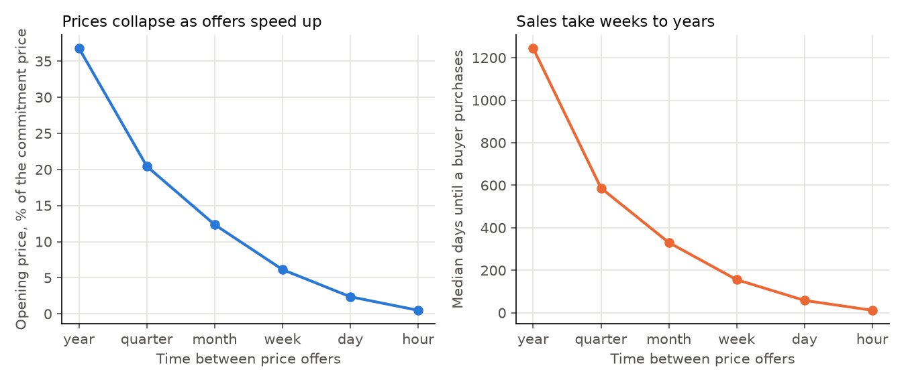
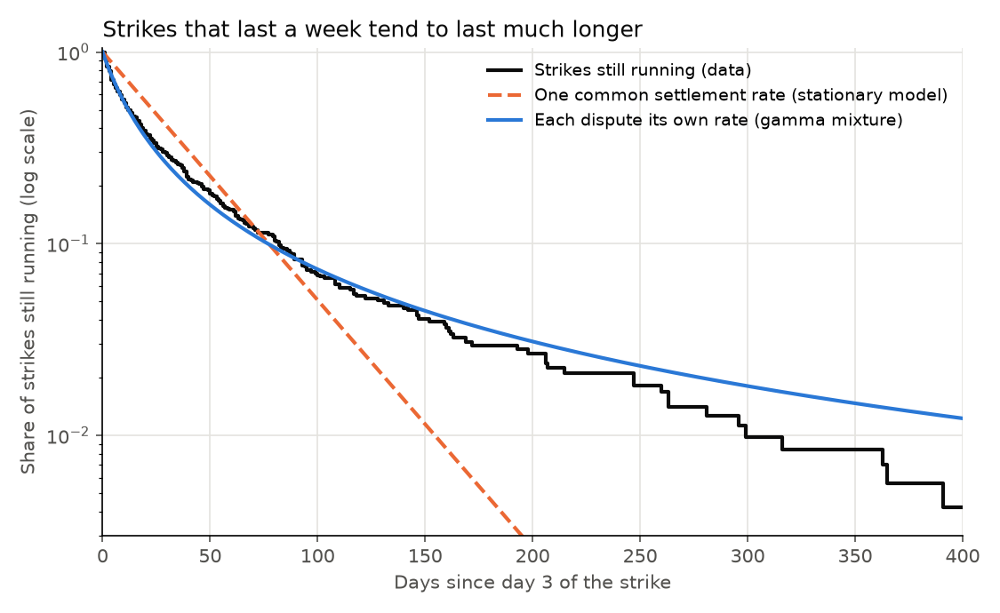
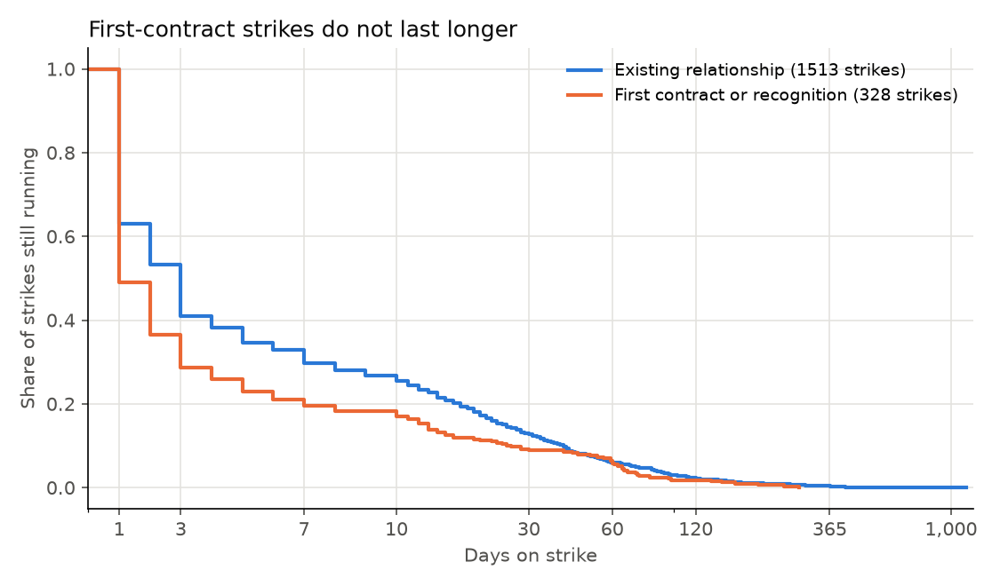

# Gul, Sonnenschein & Wilson (1986) on American strikes: findings

## In plain English

Gul, Sonnenschein and Wilson proved that a seller who can change its offer quickly, and cannot promise to hold
firm, loses its bargaining power, and that the same logic covers a negotiator screening an opponent with private
information. This repository checks what that predicts about 1,984 American strikes from 2021 to 2026.

- **The paper's arithmetic holds exactly.** Its footnote 13 numbers (0.8247, 0.3199, 0.1446) come back to four
  decimals, and with daily price changes a durable-goods seller's opening price falls to 2.4% of the commitment
  price. Delay shrinks too, but with interest as the only cost of waiting, half of buyers still wait 58 days.
- **Strikes do not settle at one constant pace.** Among strikes that reach day 4, 7.5% end on each of days 4 to
  6, but once a strike passes four months (the Writers Guild at 149 days, SAG-AFTRA's video game strike at 319)
  only 0.8% end on a given day. The stationary model with one discount factor for every dispute is rejected.
- **Dispute by dispute, a stationary model is consistent with the data.** A mix of constant settlement rates fits better than the exponential
  and Weibull curves. The typical dispute behaves as though a day of strike destroys 0.36% of the stake, about 25 times
  the daily cost of money.
- **First-contract strikes are not longer.** Strikes for a first contract or recognition (61 of the short ones at
  Starbucks) end sooner on average, and among strikes that reach day 4 the two groups are indistinguishable.

A friendlier tour is in the [README](../README.md); methods and every statistic are in
[TECHNICAL.md](../TECHNICAL.md).

**Key to the labels:** *Example 1 / Example 2* = the paper's linear-demand equilibria. *alpha* = share of
remaining buyers (or unsettled disputes) served per round. *delta* = discount factor per round. *k* = Weibull
shape (1 means a flat hazard). *theta* = squared coefficient of variation of dispute-specific settlement rates
in the gamma mixture (0 means one common rate). *Day 4+ sample* = strikes still running on their fourth day,
with time counted from day 3. *First contract* = tracker demand "First contract" or "Union recognition".
*HR* = hazard ratio; above 1 means faster settlement.

## 1. The model, reproduced (`model_examples.csv`)

Example 1 closed form against a numerical solution of its three equilibrium conditions, and Example 2's
values (shown for delta of 0.9 and above; the construction needs a large discount factor, and the paper's
own numbers use 0.9).

| delta | ex1_alpha_closed | ex1_alpha_numeric | ex1_price0 | ex1_value0 | ex1_value0_numeric | ex2_a | ex2_price0 | ex2_value0 |
|---|---|---|---|---|---|---|---|---|
| 0.5000 | 0.4142 | 0.4142 | 0.4142 | 0.2071 | 0.2071 |  |  |  |
| 0.9000 | 0.2403 | 0.2403 | 0.2403 | 0.1201 | 0.1201 | 0.8247 | 0.3199 | 0.1446 |
| 0.9900 | 0.0909 | 0.0909 | 0.0909 | 0.0455 | 0.0455 | 0.9350 | 0.1258 | 0.0608 |
| 0.9990 | 0.0307 | 0.0307 | 0.0307 | 0.0153 | 0.0153 | 0.9782 | 0.0430 | 0.0213 |

## 2. The Coase limit with interest as the only cost (`coase_limit.csv`)

Annual rate = mean Moody's Baa yield 2021–2025 (5.22%). Commitment benchmark = price 1/2, profit 1/4.

| offer_interval | delta_per_offer | share_settling_per_offer | opening_price_vs_commitment_price | seller_profit_vs_commitment | median_days_to_sale | mean_days_to_sale |
|---|---|---|---|---|---|---|
| once a year | 0.94918 | 18.4% | 36.8% | 36.8% | 1,245 | 1,619 |
| once a quarter | 0.98705 | 10.2% | 20.4% | 20.4% | 587 | 802 |
| once a month | 0.99567 | 6.2% | 12.4% | 12.4% | 330 | 462 |
| once a week | 0.99900 | 3.1% | 6.1% | 6.1% | 156 | 221 |
| once a day | 0.99986 | 1.2% | 2.4% | 2.4% | 58 | 84 |
| once an hour | 0.99999 | 0.2% | 0.5% | 0.5% | 12 | 17 |

## 3. Strike overview (`strike_overview.csv`)

Strikes starting 2021-01-01 to 2026-09-30; duration statistics and shares use the 1,841 with an end date.

| strikes | with_end_date | median_days | mean_days | share_1_day | share_1_to_3_days | share_over_30_days | share_over_100_days | max_days |
|---|---|---|---|---|---|---|---|---|
| 1,984 | 1,841 | 3.0 | 15.3 | 39.5% | 61.2% | 12.1% | 2.8% | 1,133 |

## 4. Daily settlement rate by duration, day 4+ sample (`hazard_by_duration.csv`)

| interval | strikes_at_risk | settlements | strike_days | daily_settlement_rate | ci_low | ci_high |
|---|---|---|---|---|---|---|
| days 4-6 | 714 | 148 | 1973 | 7.5% | 6.3% | 8.8% |
| days 7-13 | 566 | 178 | 3299 | 5.4% | 4.6% | 6.2% |
| days 14-29 | 388 | 163 | 4781 | 3.4% | 2.9% | 4.0% |
| days 30-59 | 225 | 113 | 4931 | 2.3% | 1.9% | 2.8% |
| days 60-119 | 112 | 71 | 4143 | 1.7% | 1.3% | 2.2% |
| day 120+ | 41 | 41 | 5185 | 0.8% | 0.6% | 1.1% |

## 5. Duration models (`duration_fits.csv`)

Rates are per day after day 3 (after day 7 for the day-8 sample). LR statistics are against the exponential;
all p-values are below 0.001.

| sample | strikes | censored | median_days_after_start | exp_daily_share | weibull_shape_k | weibull_k_ci_low | weibull_k_ci_high | lr_exp_vs_weibull | gamma_mean_rate | gamma_theta | lr_exp_vs_gamma | aic_exp | aic_weibull | aic_gamma |
|---|---|---|---|---|---|---|---|---|---|---|---|---|---|---|
| all strikes | 714 | 0 | 15 | 0.029 | 0.652 | 0.617 | 0.690 | 293.7 | 0.075 | 0.703 | 311.5 | 6446.6 | 6154.8 | 6137.0 |
| lasting 8+ days | 513 | 0 | 25 | 0.024 | 0.707 | 0.663 | 0.755 | 134.4 | 0.047 | 0.523 | 151.1 | 4861.4 | 4729.0 | 4712.3 |
| union-authorized | 606 | 0 | 17 | 0.027 | 0.670 | 0.631 | 0.711 | 219.4 | 0.065 | 0.645 | 238.5 | 5554.0 | 5336.5 | 5317.4 |
| pay among the demands | 542 | 0 | 16 | 0.029 | 0.662 | 0.621 | 0.705 | 211.0 | 0.070 | 0.651 | 230.3 | 4909.0 | 4700.0 | 4680.7 |
| 1,000+ participants | 103 | 0 | 17 | 0.031 | 0.670 | 0.577 | 0.777 | 35.0 | 0.075 | 0.702 | 36.7 | 923.0 | 890.0 | 888.3 |
| 2026 strikes with no end date censored | 753 | 39 | 17 | 0.025 | 0.620 | 0.586 | 0.657 | 349.4 | 0.075 | 0.953 | 377.0 | 6702.4 | 6355.0 | 6327.4 |

## 6. Implied discounting under Example 1 (`implied_discounting.csv`)

Percentile rows take the fitted gamma distribution of dispute rates for the day 4+ sample. "Loss per day" is
1 − delta; "multiple of interest" divides it by the daily Baa interest cost.

| what | daily_settlement_share | implied_delta_per_day | implied_loss_per_day | half_life_days | loss_per_day_vs_interest |
|---|---|---|---|---|---|
| one common rate (exponential fit) | 2.9% | 0.99908 | 0.092% | 23.3 | 6.4 |
| dispute rates, 10th percentile (gamma fit) | 1.4% | 0.99981 | 0.019% | 50.8 | 1.3 |
| dispute rates, 25th percentile (gamma fit) | 2.9% | 0.99912 | 0.088% | 23.8 | 6.1 |
| dispute rates, 50th percentile (gamma fit) | 5.7% | 0.99640 | 0.360% | 11.9 | 25.2 |
| dispute rates, 75th percentile (gamma fit) | 9.8% | 0.98828 | 1.172% | 6.7 | 82.1 |
| dispute rates, 90th percentile (gamma fit) | 14.6% | 0.97068 | 2.932% | 4.4 | 205.2 |
| interest only: Baa yield 5.22% a year, daily offers | 1.2% | 0.99986 | 0.014% | 58.3 | 1.0 |

## 7. Strikes with 10,000 or more participants (`big_strikes.csv`)

The Los Angeles hotel strike has no end date in the tracker and is excluded from the duration tests.

| employer | labor_organization | start_date | end_date | duration_days | participants |
|---|---|---|---|---|---|
| The Alliance of Motion Picture and Television Producers | Screen Actors Guild, American Federation of Television and Radio Artists (SAG-AFTRA) | 2023-07-13 | 2023-11-09 | 120 | 160,000 |
| Kaiser Permanente | Service Employees International Union (SEIU); Office and Professional Employees International Union (OPEIU); Engineers and Scientists of California - IFPTE | 2023-10-04 | 2023-10-06 | 3 | 75,000 |
| Los Angeles Unified School District | Service Employees International Union (SEIU); United Teachers of Los Angeles - AFT, NEA | 2023-03-21 | 2023-03-23 | 3 | 65,000 |
| University of California; University of California Health | University Professional Technical Employees (UPTE) - (CWA); American Federation of State, County and Municpal Employees (AFSCME) | 2025-05-01 | 2025-05-01 | 1 | 57,000 |
| University of California; University of California Health | University Professional Technical Employees (UPTE) - (CWA); American Federation of State, County and Municpal Employees (AFSCME) | 2025-04-01 | 2025-04-01 | 1 | 57,000 |
| Los Angeles County | Service Employees International Union (SEIU) | 2025-04-28 | 2025-04-29 | 2 | 55,000 |
| General Motors; Ford; Stellantis | United Auto Workers (UAW) | 2023-09-15 | 2023-10-30 | 46 | 49,700 |
| University of California | United Auto Workers (UAW) | 2022-11-14 | 2022-12-23 | 40 | 48,300 |
| Kaiser Permanente | Alliance of Health Care Unions - AFSCME; UFCW; USW; IBT; KPNAA; IUOE; AFT; UNITE HERE; ILWU; HNHP | 2025-10-14 | 2025-10-18 | 5 | 46,000 |
| Kaiser Permanente | SEIU; OPEIU; IFPTE | 2021-11-18 | 2021-11-18 | 1 | 40,000 |
| University of California; University of California Health | American Federation of State County and Municipal Employees (AFSCME) | 2024-11-20 | 2024-11-21 | 2 | 37,000 |
| University of California; University of California Health | American Federation of State, County, and Municipal Employees (AFSCME) | 2025-11-17 | 2025-11-18 | 2 | 37,000 |
| University of California; University of California Health | American Federation of State County and Municipal Employees (AFSCME) | 2025-02-26 | 2025-02-27 | 2 | 37,000 |
| Boeing | International Association of Machinists (IAM) | 2024-09-13 | 2024-11-05 | 54 | 33,000 |
| Kaiser Permanente | United Nurses Associations of California/Union of Health Care Professionals (UNAC/UHCP) - AFSCME | 2026-01-26 | 2026-03-02 | 36 | 31,000 |
| California State University | California Faculty Association (CFA) - SEIU/AAUP | 2024-01-22 | 2024-01-22 | 1 | 29,000 |
| University of California | United Auto Workers (UAW) | 2024-05-20 | 2024-06-10 | 22 | 28,300 |
| United States Maritime Alliance (USMX) | International Longshoreman's Association (ILA) | 2024-10-01 | 2024-10-03 | 3 | 25,000 |
| Kaiser Permanente | CNA - NNU; NUHW | 2021-11-19 | 2021-11-19 | 1 | 22,000 |
| University of California; University of California Health | University Professional Technical Employees (UPTE) - (CWA) | 2025-02-26 | 2025-02-28 | 3 | 20,000 |
| AT&T | Communication Workers of America (CWA) | 2024-08-16 | 2024-09-15 | 31 | 17,000 |
| New York State Department of Corrections and Community Supervision | New York State Correctional Officers & Police Benevolent Association (NYSCOPBA) | 2025-02-17 | 2025-03-10 | 22 | 15,000 |
| The Hotel Association of Los Angeles | UNITE HERE | 2023-07-02 |  |  | 15,000 |
| (16) Minnesota hospitals | Minnesota Nurses Association - NNU | 2022-09-12 | 2022-09-14 | 3 | 15,000 |
| Puerto Rico Department of Education | Teachers' Federation of Puerto Rico - FMPR; Puerto Rico Teachers Association - AFT | 2022-02-03 | 2022-02-09 | 7 | 15,000 |
| Mount Sinai Hospital; Montefiore; NewYork-Presbyterian | New York State Nurses Association (NYSNA) - NNU | 2026-01-12 | 2026-03-02 | 50 | 15,000 |
| The Alliance of Motion Picture and Television Producers | Writers Guild of America (WGA) | 2023-05-02 | 2023-09-27 | 149 | 11,500 |
| City of Los Angeles | Service Employees International Union (SEIU) | 2023-08-08 | 2023-08-08 | 1 | 11,000 |
| King Soopers - Kroger | United Food and Commercial Workers (UFCW) | 2025-02-06 | 2025-02-17 | 12 | 10,000 |
| City of Philadelphia | American Federation of State, County and Municipal Employees (AFSCME) | 2025-07-01 | 2025-07-09 | 9 | 10,000 |

## 8. The ten longest strikes with an end date (`longest_strikes.csv`)

*first_contract* = tracker demand "First contract" or "Union recognition". Participants are blank where the
tracker gives no count.

| employer | labor_organization | start_date | end_date | duration_days | participants | first_contract |
|---|---|---|---|---|---|---|
| Pittsburgh Post Gazette - Block Communications | Pittsburgh Newspaper Guild - CWA | 2022-10-18 | 2025-11-23 | 1133 | 60 | False |
| Warrior Met Coal | United Mine Workers of America (UMWA) | 2021-04-01 | 2023-03-01 | 700 |  | False |
| Dometic | United Auto Workers (UAW) | 2023-09-11 | 2024-10-30 | 416 | 103 | False |
| Euro USA | Teamsters (IBT) | 2023-03-03 | 2024-03-30 | 394 | 9 | False |
| Washington Parish School System |  | 2023-08-29 | 2024-08-30 | 368 |  | False |
| Mt Baker Roofing | Familias Unidas por la Justicia; Community to Community Development; Industrial Workers of the World (IWW) | 2023-02-13 | 2024-02-13 | 366 | 24 | False |
| Activision Productions Inc; Blindlight LLC; Disney Character Voices Inc; Electronic Arts Productions Inc; Epic Games Inc; Formosa Interactive LLC; Insomniac Games Inc; Take 2 Productions Inc; VoiceWorks Productions Inc; WB Games Inc | Screen Actors Guild - American Federation of Television and Radio Artists (SAG-AFTRA) | 2024-07-26 | 2025-06-09 | 319 | 2,600 | False |
| St. Vincent Hospital - Tenet Healthcare | Massachusetts Nurses Association | 2021-03-08 | 2022-01-03 | 302 | 700 | False |
| International Flavors and Fragrances | Bakery, Confectionery, Tobacco Workers and Grain Millers International Union (BCTGM) | 2023-06-04 | 2024-03-28 | 299 | 200 | False |
| Medieval Times Dinner and Tournament | Medieval Times Performers United - American Guild of Variety Artists | 2023-02-11 | 2023-11-21 | 284 | 25 | True |

## 9. Extension: first contract vs existing relationship

Kaplan–Meier survival and log-rank test (`gap_survival.csv`):

| sample | group | strikes | median_days | mean_days | still_running_after_7_days | still_running_after_30_days | still_running_after_60_days | still_running_after_120_days | logrank_chi2 | logrank_p |
|---|---|---|---|---|---|---|---|---|---|---|
| all strikes | existing relationship | 1513 | 3.000 | 16.196 | 0.297 | 0.128 | 0.060 | 0.022 | 14.115 | 0.0002 |
| all strikes | first contract or recognition | 328 | 1.000 | 11.247 | 0.195 | 0.088 | 0.058 | 0.018 | 14.115 | 0.0002 |
| lasting 4+ days | existing relationship | 620 | 16.000 | 37.245 | 0.724 | 0.311 | 0.147 | 0.053 | 0.003 | 0.9543 |
| lasting 4+ days | first contract or recognition | 94 | 13.000 | 35.766 | 0.681 | 0.309 | 0.202 | 0.064 | 0.003 | 0.9543 |

Cox regressions with start-year effects, standard errors clustered by employer (`gap_cox.csv`):

| sample | variable | coef | se_clustered | hazard_ratio | p | n | employer_clusters |
|---|---|---|---|---|---|---|---|
| all strikes | first | 0.184 | 0.066 | 1.202 | 0.0056 | 1841 | 1217 |
| all strikes | log_participants | -0.051 | 0.032 | 0.950 | 0.1153 | 1841 | 1217 |
| all strikes | participants_missing | 0.037 | 0.079 | 1.038 | 0.6412 | 1841 | 1217 |
| all strikes | authorized | -0.490 | 0.147 | 0.613 | 0.0009 | 1841 | 1217 |
| lasting 4+ days | first | -0.044 | 0.113 | 0.957 | 0.6932 | 714 | 624 |
| lasting 4+ days | log_participants | 0.020 | 0.023 | 1.020 | 0.3974 | 714 | 624 |
| lasting 4+ days | participants_missing | -0.124 | 0.135 | 0.883 | 0.3573 | 714 | 624 |
| lasting 4+ days | authorized | -0.446 | 0.121 | 0.640 | 0.0002 | 714 | 624 |

Gamma-mixture fits by group, day 4+ sample (`gap_gamma_fits.csv`):

| group | strikes_lasting_4plus | gamma_mean_daily_rate | gamma_theta | median_dispute_daily_share | median_dispute_loss_per_day | share_over_60_days | share_over_120_days |
|---|---|---|---|---|---|---|---|
| existing relationship | 620 | 0.0732 | 0.6800 | 0.0558 | 0.0035 | 0.1468 | 0.0532 |
| first contract or recognition | 94 | 0.0913 | 0.8929 | 0.0639 | 0.0047 | 0.2021 | 0.0638 |

Short strikes by group (`gap_short_strikes.csv`):

| group | strikes | ended_within_3_days | most_common_employer_among_them | its_count |
|---|---|---|---|---|
| existing relationship | 1513 | 893 | Starbucks | 126 |
| first contract or recognition | 328 | 234 | Starbucks | 61 |

Longest first-contract strikes (`gap_longest_first_contract.csv`):

| employer | labor_organization | start_date | end_date | duration_days | participants |
|---|---|---|---|---|---|
| Medieval Times Dinner and Tournament | Medieval Times Performers United - American Guild of Variety Artists | 2023-02-11 | 2023-11-21 | 284 | 25 |
| Distinguished Concerts International New York | American Federation of Musicians (AFM) | 2023-02-16 | 2023-10-23 | 250 | 100 |
| Boston University | Boston University Graduate Workers Union - SEIU | 2024-03-25 | 2024-10-11 | 201 | 3,000 |
| Batesville Products | Teamsters (IBT) | 2026-05-11 | 2026-10-23 | 166 | 0 |
| Breakthru Beverages | Teamsters (IBT) | 2025-06-03 | 2025-10-29 | 149 | 860 |
| Homegrown | UNITE HERE | 2023-10-30 | 2024-03-13 | 136 | 30 |
| Great Lakes Coffee Roasting Company | UNITE HERE | 2022-02-16 | 2022-05-24 | 98 | 20 |
| Starbucks | Starbucks Workers United - SEIU | 2025-11-13 | 2026-02-16 | 96 | 4,500 |
| Writers Guild of America West | Writers Guild Staff Union (WGSU) - Pacific Northwest Staff Union (PNSU) | 2026-02-17 | 2026-05-09 | 82 | 115 |
| Worcester Polytechnic Institute (WPI) | Resident Advisors Union (RAU) - (UAW) | 2025-10-31 | 2026-01-13 | 75 | 30 |

